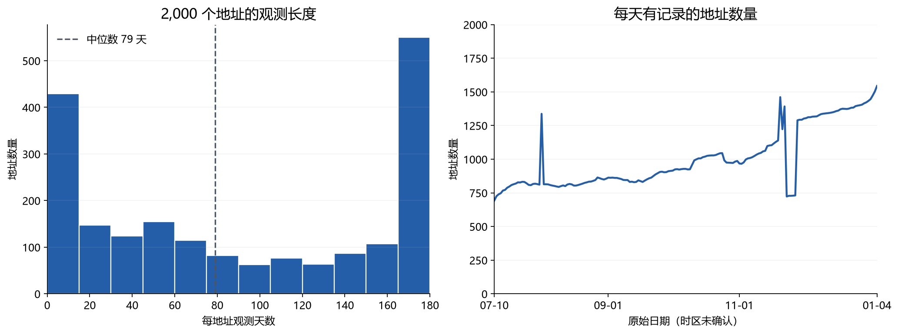
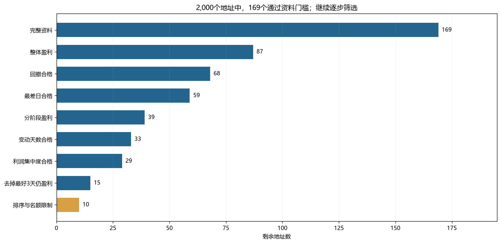
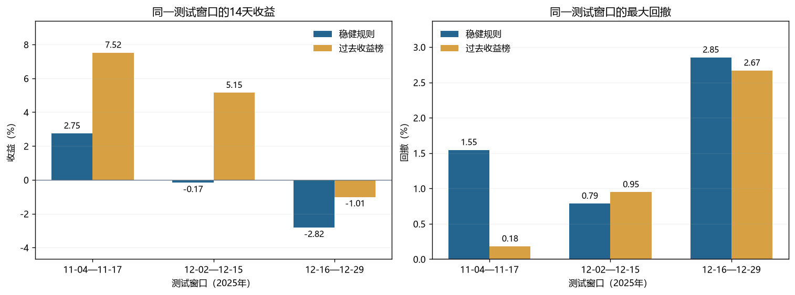

# Hyperliquid 多交易员跟随策略的可复制性研究

**独立量化研究项目｜研究报告 v1.1**  
报告整理日期 2026-10-10｜数据区间 2025-07-10 至 2026-01-04  
研究对象为外部提供的 2,000 个地址级账户日快照｜真实跟随交易及资金投入均为 0

> **研究结论**  这份数据可以支持一项可复核的历史选人实验，却不足以证明真实跟随收益。固定筛选规则在双方资料完整的三个 14 日向前窗口中，收益均落后于同口径的过去收益榜，平均每轮低 3.97 个百分点。账户字段、缺失记录和执行资料的限制，使历史名单只能作为后续影子研究对象。研究下一阶段应收集完整持仓与逐笔事件，在同预算、含成本的前瞻协议下重新检验。

## 摘要

公开可观测的交易员业绩常被用作跟随策略的选人依据，但账户收益、可预测的交易能力和跟随者实际净收益是不同的研究对象。本项目以 2,000 个 Hyperliquid 地址、179,355 条日度账户记录为样本，先审计数据可用性，再构造带有现金流调整的条件收益代理，随后固定 60 日训练与 14 日观察的选人实验。主规则要求收益持续、回撤和单日亏损受限、盈利不过分集中，并在排序后限制高相关地址；对照组在相同资料门槛下按过去收益排序。

八轮未来窗口中，双方共同完整的只有三轮。主规则三轮收益差均为负，平均低 3.97 个百分点，回撤没有整体改善。十一种配置的参数诊断也未给出稳定优势。原始数据的账户范围和净入金定义未经数据提供方确认，1,317 个地址存在断档，17,003 行存在金额关系差异，且没有持仓、成交和盘口，因此不能由现有实验推导真实跟随者的成本后收益。本研究保留负面结果，提出下一阶段的数据接入、影子成交和同预算对照协议。其贡献是一套可复核的研究流程与明确的证据边界，尚未证明可投资的交易策略。

**关键词**  跟随交易；交易员筛选；数据审计；向前验证；执行成本；回测偏差

## 1. 研究动机与问题

跟随一个地址，实际需要在来源账户改变持仓后识别目标，再以自己的资金、订单规则和风险限额成交。地址历史权益只给出来源账户的最终状态，并不告诉研究者持仓何时变化、能否在相近价格复制，或者平仓时是否有足够流动性。本项目从这个落差出发，将研究拆成三个连续问题。

| 研究问题 | 可用证据 | 本轮能够回答到哪里 |
| --- | --- | --- |
| RQ1 账户日记录能否形成可比较的收益 | 权益、净入金、PnL、时间戳与数据审计 | 仅部分连续区间能计算条件收益代理 |
| RQ2 固定的稳健选人规则能否优于简单对照 | 八轮过去 60 日选人、未来 14 日观察、同窗配对 | 三轮共同完整窗口未支持规则优势 |
| RQ3 历史账户收益能否转化为跟随者净收益 | 来源持仓、事件时间、订单、盘口、费用与我方账本 | 关键数据缺失，尚不能检验 |

**主研究假设 H1。**在相同资料条件和相同模型资本下，限制历史亏损、盈利集中度与候选间相关性的选人规则，未来 14 日表现优于仅按过去 60 日收益排序的对照。H1 针对整套规则，实验结果不能直接分解为某一门槛的独立因果贡献。

**后续研究假设 H2。**若取得完整事件数据，跟随经核实的目标仓位变化，在实际成本、延迟和统一风险限制之后仍能获得正的净收益。现有日快照不能检验 H2。资金配置与运行规则在本报告中仅作为前瞻研究设计。

这是一项基于外部数据包的独立研究。数据提供方没有提供地址抽样方式、字段字典或采集过程，因此本项目不声称取得全平台随机样本，也不声称作者独立抓取了平台历史数据。

## 2. 数据与测量

### 2.1 样本来源和质量

原始数据包含 2025-07-10 至 2026-01-04 的 179 个日期，共 179,355 行、2,000 个地址。地址和日期的组合唯一，单元格没有空值。账户观测天数中位数仅 79 天；1,317 个地址的首末记录之间有缺日，合计缺少 67,289 个地址日。414 个地址共同缺少 2025-11-23 至 27 日记录。共同缺口更像需要核实的采集或导出事件，不能自动记作交易员当日零收益。

**表 1 主要数据审计结果**

| 指标 | 结果 | 研究处理 |
| --- | ---: | --- |
| 地址数与记录数 | 2,000 / 179,355 | 全部保留，先审计再筛选 |
| 有观测断档的地址 | 1,317 | 不跨缺日拼接日收益 |
| 地址跨度内缺少的地址日 | 67,289 | 报告窗口覆盖率，不将缺失补零 |
| 金额关系差异超过 0.01 的记录 | 17,003 | 保留原值，相关区间记为口径未决 |
| 零权益记录 | 3,145 | 全部位于首次正权益之前，不解释为爆仓 |
| 地址观测天数中位数 | 79 | 连续 60 日训练门槛会显著缩小样本 |

**图 1 地址观测长度与每日覆盖数量**

*注。左图展示 2,000 个地址的观测天数分布，右图展示每天有记录的地址数量。日期原始时区尚未确认。样本期 2025-07-10 至 2026-01-04。来源为[数据审计程序和已执行 Notebook](../analysis/audit_data.py)。*

17,003 条记录的 `equity` 低于 `net_deposit + pnl`，差额超过 0.01；548 个地址的差额随时间变化。该现象可能与不同账户范围或字段生成方式有关，当前文件无法确认具体原因。研究没有把 `net_deposit + pnl` 强制写回权益，也没有仅按看起来更好的口径筛选收益。

### 2.2 账户条件收益代理

暂将 `net_deposit` 解释为累计净入金。设相邻快照权益为 $E_{t-1}$ 和 $E_t$，累计净入金变化为 $F_t=D_t-D_{t-1}$，则代理利润与收益定义为

$$
G_t=E_t-E_{t-1}-F_t,\qquad
r_t=\frac{G_t}{E_{t-1}+0.5F_t}.
$$

这里把净现金流放在区间中点，是缺少逐笔流量时点时的近似。CFA Institute 的 GIPS 计算资料区分了中点假设与按流量真实发生时间加权的方法。[1] 本项目没有足够信息计算精确的时间加权收益，也没有 GIPS 认证。

主实验要求期初权益、期初资金情景分母和中点分母均为正，收益有限且不低于 -100%；相邻快照间隔须为 18 至 30 小时，端点金额关系差额绝对值不超过 0.01。训练期再要求每日期初权益至少 1,000 原数据单位，日净流量绝对比例不超过 10%。有 95 个区间虽然能算中点收益，但期初资金情景分母无效，因此从主收益中隔离。可确认的极端损失保留；不可解释的区间标记未知。

上述处理提高了可比较性，也改变了样本构成。审计示例条件下可进一步研究的区间有 139,816 条，涉及 1,753 个地址，但拥有至少 60 个连续合格区间的地址只有 360 个。资料门槛可能偏向记录连续、账户资金流较平稳的人。原始 2,000 人如何入池未知，幸存者偏差无法排除。

## 3. 实验设计

### 3.1 时间顺序和协议冻结

每轮在决策日只使用过去 60 个日收益区间，固定名单后观察未来 14 天。八个观察窗口互不重叠，测试区间从 2025-09-09 延续至 2025-12-29；余下六天单列，不冒充完整轮次。训练窗口可以重叠。历史参数及原数据哈希在本轮策略未来收益计算前记录。此前已经对全份数据做结构审计，并看过少量仅训练期的可行性窗口，因此该实验属于**在已接触数据上固定规则后进行的向前检验**，不是严格未触碰的外部盲样本。

冻结配置记录见[实验摘要](../results/protocol_record.json)。原数据 SHA-256 为 `cb2a16931470cecaeb16a35af150788e53ea2762963edad98b44902ff8d00705`，原选人配置 SHA-256 为 `be6a6144434d0338d1a06522583ecc4f7990d7f00ca1a09956357045568ccccc`。

### 3.2 选人规则与对照

通过资料门槛后，候选地址需要满足 60 日复利收益为正；三个连续 20 日阶段至少两个盈利；至少 20 个日收益绝对值超过 0.01% 的非静止日；历史最大回撤不超过 20%，最差单日收益不低于 -10%。盈利集中度进一步要求最好三天正对数收益贡献不超过全部上涨日的 60%，把这三天收益设为零后仍盈利。

合格者按平均日对数收益与下行波动之比排序，波动分母下限为 0.5%；依次加入候选，若与已入选者的正相关超过 0.7 则暂缓，最多保留十人。利润集中度诊断只作用于**过去训练期**，未来测试不会删除任何赚或亏的日期。[完整规则与固定顺序](../analysis/selection_config.json)可以逐项复核。

主对照组通过**同一资料门槛**，按过去 60 日收益排序取最多十人。两组在历史比较中每名入选者占 10% 合成资本权重，不足十人的余量留现金。每日固定模型权重隐含再平衡，未模拟手续费、滑点、延迟、资金费差异、实际换手或容量。另保存资料合格地址等权、取消相关性限制的诊断对照。

### 3.3 评价指标和未知值

每轮报告完整 14 日收益、最大回撤、最差日、可观测日数与未知配置份额。若已配置地址在某日缺少可解释收益，该日整个合成组合收益记为未知；名单不补人、缺失不补零、整轮不计算完整收益。主比较只使用同一窗口双方都完整的配对结果，收益差定义为主规则 14 日收益减收益榜 14 日收益，单位为**百分点**。

该缺失规则可能使可评价样本变少，却能避免把缺失日期误认作没有损失。完整窗口是一个条件样本，缺失并非已证实随机，故完整轮均值不能自动代表全部八轮的无条件表现。

## 4. 实证结果

### 4.1 筛选漏斗与历史名单

在最后一次截至 2026-01-04 的 60 日窗口中，2,000 个地址里 169 个达到资料门槛，15 个同时通过全部表现门槛，按排序、相关性和十人上限留下十个历史观察候选。169 是资料可评价人数，不是“值得投资的人数”。

**图 2 最后一次历史筛选漏斗**

*注。柱长为固定顺序逐步筛选后的剩余地址数，换顺序会改变中间数字。研究截止 2026-01-04。来源为[逐步筛选记录](../results/final_selection_steps.csv)。*

### 4.2 八轮向前观察与可观测性

**表 2 八轮未来窗口的完整性与条件收益**

| 14 日窗口（2025） | 主规则可观测日 | 收益榜可观测日 | 主规则整轮收益 | 收益榜整轮收益 |
| --- | ---: | ---: | ---: | ---: |
| 09-09 至 09-22 | 14/14 | 2/14 | -5.94% | 未知 |
| 09-23 至 10-06 | 4/14 | 13/14 | 未知 | 未知 |
| 10-07 至 10-20 | 6/14 | 10/14 | 未知 | 未知 |
| 10-21 至 11-03 | 14/14 | 8/14 | +5.14% | 未知 |
| 11-04 至 11-17 | 14/14 | 14/14 | +2.75% | +7.52% |
| 11-18 至 12-01 | 6/14 | 6/14 | 未知 | 未知 |
| 12-02 至 12-15 | 14/14 | 14/14 | -0.17% | +5.15% |
| 12-16 至 12-29 | 14/14 | 14/14 | -2.82% | -1.01% |

主规则五轮可计算完整收益，收益榜三轮完整。两组同时完整的只有最后三轮。用不同日期的五轮均值与三轮均值比较，会把资料覆盖差异误当成策略差异。上述结果来自[逐轮原始输出](../results/forward_folds.csv)。

### 4.3 同窗配对的主结果

**表 3 三个共同完整窗口的收益与回撤**

| 测试窗口（2025） | 主规则 14 日收益 | 收益榜 14 日收益 | 收益差 | 主规则回撤 | 收益榜回撤 |
| --- | ---: | ---: | ---: | ---: | ---: |
| 11-04 至 11-17 | +2.75% | +7.52% | -4.77 pp | 1.55% | 0.18% |
| 12-02 至 12-15 | -0.17% | +5.15% | -5.32 pp | 0.79% | 0.95% |
| 12-16 至 12-29 | -2.82% | -1.01% | -1.81 pp | 2.85% | 2.67% |

**图 3 三个共同完整窗口的配对结果**

*注。收益与回撤均是按账户条件收益构造的无实际跟单成本合成组合结果。图中不是可成交净值。来源为[逐轮配对记录](../results/paired_fold_details.csv)。*

主规则三轮收益全部低于对照，平均每轮低 **3.97 个百分点**。平均最大回撤高约 **0.46 个百分点**。因此 H1 没有得到本次数据支持。共同完整样本只有三轮，不能估计稳健的显著性、长期胜率或年化超额收益；收益榜在这三轮领先也不能证明其长期一定优越。

### 4.4 失败案例与参数诊断

一名通过 2025-09-08 历史筛选的地址，训练期 60 日条件收益为 +32.36%，最大回撤 5.88%；随后资料完整的 14 日条件收益却为 **-81.50%**。该亏损被保留。缺少持仓和成交资料，无法判定其交易原因，也无法把这个比例直接转成跟随者损益。它清楚表明历史风险门槛不能保证未来损失上限。

原规则加十个预列变体共 11 个配置，所有配置在各自共同可评价窗口中相对同预算收益榜的平均差都为负。观察长度尤其影响最终名单，训练 45 日与原十人只重合 1 人，训练 90 日只重合 3 人。90 日版本覆盖的决策点更少，不能从这些异期均值中挑出“最佳参数”。完整记录在[参数敏感性表](../results/parameter_sensitivity.csv)。事后挑选回测表现最佳的版本会提高过拟合风险，本研究没有提升任何变体为新的主规则。[2]

## 5. 结果解释与研究限制

这项实验给出的最直接结论是固定规则**没有在可比较历史窗口中体现优越性**。可能的原因包括过滤条件放弃了随后强势的来源、市场环境改变、短样本的随机波动、账户收益代理存在误差。没有持仓、品种或市场暴露资料，当前无法区分这些解释，更不能把落后归因到某一道具体门槛。

数据存在四个会改变解释的限制。地址池的原始抽样可能有选择或幸存者偏差；净入金、PnL 和权益的账户范围未核实；地址间的日快照并不严格同步；未来缺失可能与账户行为或数据采集质量相关。完整窗口配对减少了不公平比较，却不能消除这些来源性问题。

本项目还留下一个重要边界。训练规则虽在本轮未来策略成绩计算前冻结，但研究者先前已经查看过全份数据的结构，并做过少量训练期可行性检查。这不是严格从未接触数据的外部盲样本。历史实验适合用来否定过强的收益主张，证明长期可投资性仍需要新的前瞻样本。

## 6. 可复制性与下一阶段研究

真实跟随者首先需要识别来源完整持仓，再按经核实的账户权益缩放目标，经过组合风控后汇总成可执行的真实合约净仓。目标仓位和来源账户当日最终收益之间没有一条无需延迟与成本的直接映射。要检验 H2，至少需要下列逐事件记录。

**表 4 真实跟随收益的最小数据要求**

| 研究环节 | 必需数据 | 当前数据状态 |
| --- | --- | --- |
| 来源状态 | 完整持仓、合约键、权益、资金流、杠杆 | 缺失 |
| 事件时间 | 来源事件、我方接收、决策、提交、成交时刻 | 缺失 |
| 市场可执行性 | 对应时刻盘口、深度、成交量和订单终态 | 缺失 |
| 跟随者净收益 | 真实成交、手续费、滑点、资金费、库存估值 | 缺失 |
| 风险退出 | 在途订单、实际净仓、撤单终态与最终对账 | 缺失 |

现有运营方案设置过常规与压力成本情景。常规情景将单边手续费下限设为 5 bp、滑点设为 5 bp、信号到执行延迟设为 2 秒；这些数字是研究假设，并非平台统一费率或实测值。历史 CSV 没有逐笔换手，不能给账户收益机械扣一个固定成本后声称得到了跟随者净收益。前瞻采集与订单状态设计可参考 Hyperliquid 官方账户、订单和限流文档。[3][4][5]

下一阶段按预先冻结的流程推进。先核实字段字典与账户范围，采集新的连续持仓和交易事件；然后在真实资金为 0 的影子系统中记录自然交易生命周期、可见盘口、拟单与模拟成交、拒单和遗漏。完成逐来源执行健康核验后，再从共同安全准入池分别按主规则与过去收益榜选人。两组影子账户以相同实际可分配资本、相同成本与风险约束，在预定的非重叠窗口中比较。名单和权重相同的窗口保留在全期收益里，却不能被当作选人方法的区分证据。

预算规则、风险阈值、故障演练和小额技术验证可以在这一阶段作为**实验控制条件**，不等同于已验证的策略收益。任何真实资金试验都需要独立的逐来源准入、成本和容量证据。若新样本仍不支持 H1 或 H2，应记录失败并停止该版本，而非重选历史窗口或仅报告盈利账户。

## 7. 研究贡献与结论

本项目留下了四项可复核成果。第一，原始 2,000 地址数据的质量画像和收益可用性标记保留了缺失、金额冲突和极端亏损。第二，一套固定的训练、筛选、对照与未来评价协议，使地址名单由过去资料产生，并对“未知”采取一致处理。第三，八轮结果、同窗配对和参数诊断如实报告了不利于主假设的发现。第四，前瞻协议明确了把来源账户业绩升级为跟随者可复制净收益还需要哪些事件数据和执行检验。

本研究目前证明的是**研究过程可审计，并发现一项未获支持的选人假设**。它没有证明存在正的交易 alpha，没有完成实盘验证，也未形成正式发表的学术成果。作为独立量化研究项目，其可展示价值在于把数据审计、事前规则、对照实验、失败案例与可交易性边界连成一个完整研究链条。下一份真正能改变资金决策的证据，应来自新时期、同预算、成本后且保留所有预定窗口的前瞻比较。

## 附录 A 研究产物与复现路径

| 研究阶段 | 公开产物 | 可复核内容 |
| --- | --- | --- |
| 原始数据审计 | [审计程序](../analysis/audit_data.py)、[汇总](../results/audit_summary.json) | 行数、缺失、金额关系与收益口径 |
| 固定选人实验 | [实验程序](../analysis/selection_experiment.py)、[配置](../analysis/selection_config.json)、[协议记录](../results/protocol_record.json) | 时间顺序、阈值及数据版本哈希 |
| 历史结果 | [八轮输出](../results/forward_folds.csv)、[同窗配对](../results/paired_fold_details.csv)、[对照汇总](../results/paired_comparisons.csv) | 覆盖率、收益差与回撤 |
| 稳健性诊断 | [参数敏感性](../results/parameter_sensitivity.csv)、[独立验证代码](../analysis/validate_selection.py) | 11 种配置与原始 CSV 复算逻辑 |
| 后续协议 | [前瞻比较设计](../docs/prospective_protocol.md) | 数据接入、成本及同预算影子实验 |

原始 CSV 的 SHA-256 为 `cb2a16931470cecaeb16a35af150788e53ea2762963edad98b44902ff8d00705`；原始选人配置 SHA-256 为 `be6a6144434d0338d1a06522583ecc4f7990d7f00ca1a09956357045568ccccc`。公开仓库不分发原始数据及地址级明细，因此公开结果可直接核对，但完整重跑需要另行取得相同数据版本。代码内保留来源与配置哈希检查，用来防止把其他数据运行结果误记为本次研究。这里记录的是离线实验，不代表真实 API、实盘交易或正式发表。

## 参考文献

1. CFA Institute. [GIPS Guidance Statement on Calculation Methodology](https://www.gipsstandards.org/wp-content/uploads/2021/03/calculation_methodology_gs_2011.pdf). 用于现金流加权收益方法的边界说明；本项目不声称符合 GIPS 认证。
2. Bailey, D. H., et al. [The Probability of Backtest Overfitting](https://www.davidhbailey.com/dhbpapers/backtest-prob.pdf). 用于解释多次参数尝试后的选择风险；本研究未计算 PBO。
3. Hyperliquid Docs. [Perpetuals information endpoints](https://hyperliquid.gitbook.io/hyperliquid-docs/for-developers/api/info-endpoint/perpetuals).
4. Hyperliquid Docs. [Exchange endpoint](https://hyperliquid.gitbook.io/hyperliquid-docs/for-developers/api/exchange-endpoint).
5. Hyperliquid Docs. [Rate limits and user limits](https://hyperliquid.gitbook.io/hyperliquid-docs/for-developers/api/rate-limits-and-user-limits).

官方接口资料仅支持未来采集与执行设计，不能倒推这份历史数据的字段含义或当时可成交性。
